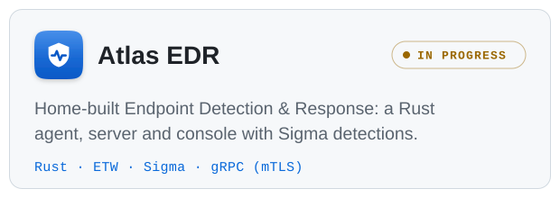
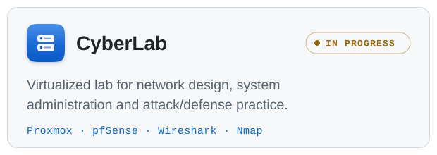
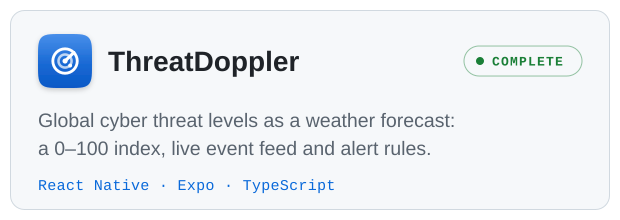
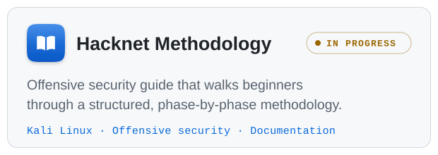
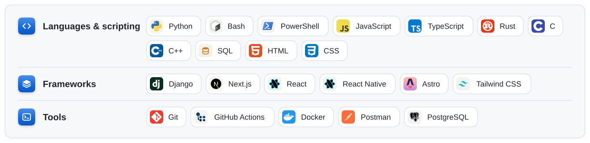

<picture>
  <source media="(prefers-color-scheme: dark)" srcset="./header-dots-shield-dark.svg">
  
</picture>

  
  &nbsp;
  
  &nbsp;
  
  &nbsp;
  

Cybersecurity senior at **Grand Canyon University**, most recently an **Infrastructure & Endpoint Security Intern** (summer 2026). I'm building my own EDR in Rust, I run a home lab to practice defending real networks, and I write full-stack apps with security at the core.

<!-- Recruiter tip: add one line here such as "Open to full-time security roles from May 2027." -->

<!--
## Experience
**Infrastructure & Endpoint Security Intern** · Company name · Jun – Aug 2026
- One line on what you worked on, for example endpoint hardening, patching or monitoring
- One line with a result, ideally with a number
-->

## Featured projects

  <a href="https://github.com/jakefrenzel/atlas-edr"><picture>
    <source media="(prefers-color-scheme: dark)" srcset="./card-atlas-edr-dark.svg">
    
  </picture></a>
  <a href="https://github.com/jakefrenzel/jakefrenzel-cyberlab"><picture>
    <source media="(prefers-color-scheme: dark)" srcset="./card-cyberlab-dark.svg">
    
  </picture></a>
  <a href="https://github.com/jakefrenzel/ThreatDoppler"><picture>
    <source media="(prefers-color-scheme: dark)" srcset="./card-threatdoppler-dark.svg">
    
  </picture></a>
  <a href="https://github.com/jakefrenzel/hacknet-methodology"><picture>
    <source media="(prefers-color-scheme: dark)" srcset="./card-hacknet-dark.svg">
    
  </picture></a>

## Skills

<picture>
  <source media="(prefers-color-scheme: dark)" srcset="./skills-security-dark.svg">
  
</picture>

#### Development

<picture>
  <source media="(prefers-color-scheme: dark)" srcset="./skills-dev-dark.svg">
  
</picture>

<!--
## Certifications
- Add certifications here, for example CompTIA Security+ (2026)
-->
